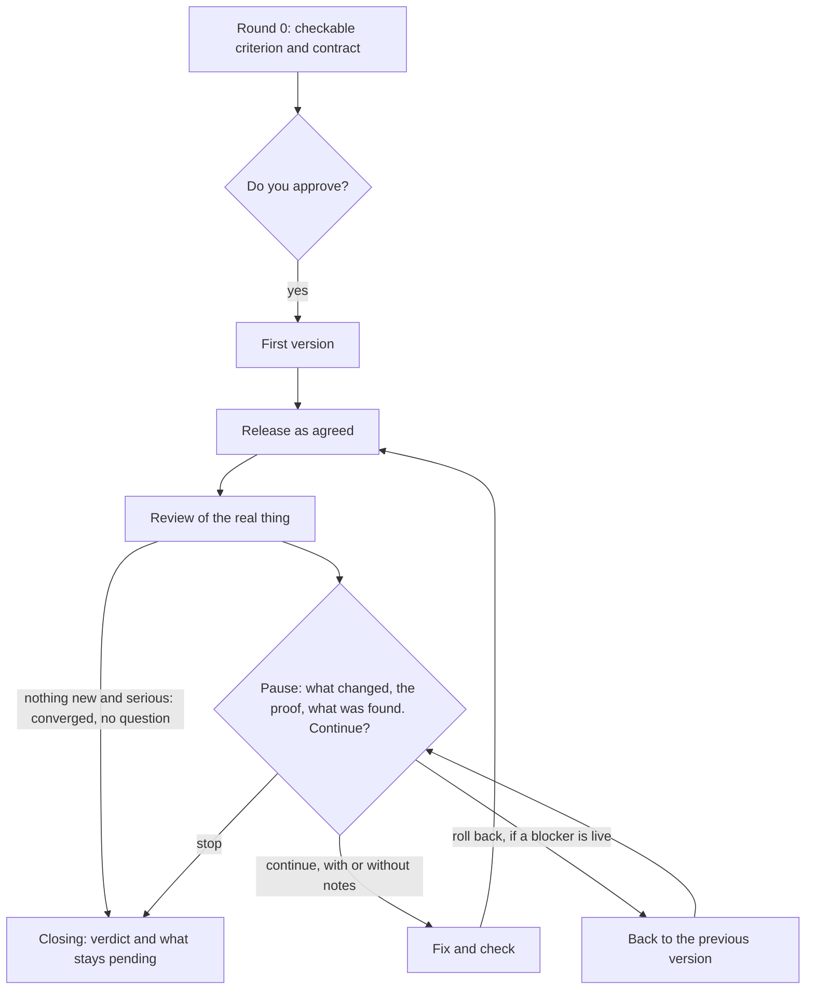

# sota

[Português](README.md) · **English**

**AI answers confidently. How do you know which answer to trust? sota has AI reviewers work apart, each with its own method, shows the evidence for each finding, says how much was checked, and gives back an improved version.**

It takes anything written or built: a plan, a text, a decision, code, a screen.

sota is a *skill*, a package of instructions that teaches an AI agent to work in a specific way. It has only been tested on [Claude Code](https://code.claude.com/docs), Anthropic's agent that works with the files on your computer, and it needs a paid Claude plan or an API key. In a chat window, such as ChatGPT's, it has not been tested: without separate agents, it would fall back to a weaker mode.

## An example: the school bake-sale plan

To test it, we made up a plan of the kind a school volunteer might write: raise $5,000 for the library on one Saturday by selling 50 cakes at $10, from 9 to 11 am. Its last item says: "Food safety is not a concern because everything is homemade."

The skill answered **NOT YET**, with this:

- **The sums fall short.** 50 × $10 is $500, a tenth of the goal. Even selling everything, $4,500 would be missing.
- **The food-safety sentence is false.** A reviewer opened official health rules and quoted them, so you can check for yourself.
- **The goal bundled a need with a method.** The library needs books. "One Saturday" and "cakes" were only one route.
- **The plan came back rewritten**, with donations, rules for the cakes and someone in charge of the money. Fresh reviewers tested that version, and the first found a timeline nobody could follow. The last adjustments were not re-checked, and the report says which numbers are judgment calls.

Not everything came out proven: two of the seven serious findings stayed as coherent but unchecked (`plausible`), and the report says so. The original plan was not touched. The decision stays with whoever wrote it, now with sources to check. Anyone careful would have caught the sum; the value lies in the sources opened, the questioned objective and the rewritten version. [Read the full report](examples/bake-sale-review.md), real and unedited.

### The rationale in five lines

- AI doesn't show its work, and different characters think alike → **reviewers differ by method and point to their evidence** → you check instead of believing.
- Agents that read each other's work converge → **each one works alone** → one does not drag the others along.
- Whoever reached a conclusion is a poor judge of it → **an agent that did not see the discussion checks the blockers, the problems that would defeat the objective** → the check does not inherit the reasoning of whoever concluded.
- In a long process, rounds with no pause decide for you → **you decide at every round, and no message goes out and nothing is published unless agreed first** → the veto stays yours.
- All of this is a bet, not a result: nobody has measured whether it beats one careful reviewer.

[The full story](#why-it-works-this-way) is further down.

## What do you want right now?

| Your question | Mode | What happens | What changes in the original |
|---|---|---|---|
| "Is this good? What am I missing?" | **Review** (`review`) | One round of review, a report and an improved version | Nothing, by instruction ([limits](#cost-and-limits)) |
| "I want this to improve until it stops being worth continuing" | **Loop** (`loop`) | Rounds of fixing, checking and reviewing, stopping for you to decide | Only what you authorized |

When in doubt, start with a Review. It costs less and is instructed not to touch the original.

**Don't use it for** quick factual questions, trivial edits, or anything a cheap test could settle right now.

> **Before installing:** the two `standard` Reviews we measured cost $7 and over $18, paying per use. That is not a range or a cap: longer material, debate and `deep` cost more, and neither `deep` nor a full Loop has been measured. On a subscription, it draws on your plan's allowance, and we have not measured how much. Both modes run code and search the web without asking on their own: if this computer has access to real accounts or databases, run it elsewhere or without that access. In `deep`, your material may also go to another AI vendor. The result does not replace a professional. [Cost and limits](#cost-and-limits).

## Start here

**1. Get Claude Code.** If you have never used it, install the [Claude app](https://code.claude.com/docs/en/desktop-quickstart), sign in and open the **Code** tab. It takes a paid plan (Pro or above). If you prefer the terminal, follow the [quickstart](https://code.claude.com/docs/en/quickstart), which also accepts a pay-per-use API key.

**2. Install the skill.** Both routes use git. If you don't have it, install [Git](https://git-scm.com/downloads) first.

- **In the app** (we have not tested this route yet): in the Code tab, pick **Local** in the environment selector and any folder. Paste the message below.
  ```
  Copy the skills/sota folder from https://github.com/phrbarbosa/sota to my personal skills folder (~/.claude/skills/sota; on Windows, inside my user folder). Do not install or run anything else.
  ```
  Approve only creating the folder, downloading and copying, and refuse anything else. The folder holds only text files, but they are instructions the agent will follow, and you can read them first. Then open a new session and type `/`: `sota` should appear in the list, and the command will be `/sota`. If it does not, ask the agent to check that `SKILL.md` exists in that folder. To update or remove it, ask the agent to replace or delete that folder.
- **In your regular terminal**, not inside a Claude Code session (tested on a clean install). The command will be `/sota:sota`.
  ```bash
  claude plugin marketplace add phrbarbosa/sota
  claude plugin install sota@phrbarbosa-sota
  ```

**3. Open your file's folder.** In the app, pick the local environment and your file's folder. In the terminal, go to the folder and type `claude`. The agent reads text and PDF; if your file is Word, save it as PDF first.

**4. Ask**, swapping `plan.md` for your file and saying what the objective is. Without one, it infers an objective and says so. If you installed through the message, use `/sota` instead of `/sota:sota`, here and in the examples below.

```
/sota:sota review the plan in plan.md; the objective is to pay for the library's books
```

**5. Wait and read.** It says in one line how many agents it will start and begins without waiting for an answer, because you called it by name. Expect several minutes: we measured about 7 for a `lite` Review and 16 for the start of a Loop, and have not timed a `standard` one. If Claude Code asks permission to search the web or run a command, read the request: refusing can leave a reviewer unfinished, and the report says so. At the end come the verdict, what to change and the improved version, in full if the material is small or as a list of changes if it is large.

Other requests:

```
/sota:sota review the diff on this branch; it is a risky migration
/sota:sota review deep: should we switch suppliers this quarter?
/sota:sota review lite the plan in plan.md
/sota:sota loop our signup page; goal: a first-time user finishes in under a minute
/sota:sota loop the proposal in proposal.md, paper only
/sota:sota continue signup-page
```

- **Level.** The default is `standard`, and `deep` uses more agents and costs more. `lite` is cheaper because one agent does all five readings, with no separate reviewers and no debate; at most, one fresh agent checks the improved version. It suits something small and reversible, not a decision that is hard to undo or anything the same session just produced. The Loop never uses `lite`.
- **Loop.** First it proposes a criterion and a contract for what it may release, and waits for your approval. `continue` resumes by the name it gave you at the start. "Paper only" means reviewing and rewriting the document without putting anything into use, and it tends to need more rounds.
- **Plain language.** You can ask "red team this". In that case it states the cheaper option and waits for your yes. If it does not announce what it will start, it did not fire: use the command.
- **Language.** The report comes back in the language of your request, as in this [example in Portuguese](examples/revisao-lite-biblioteca.md).

<details>
<summary>Other ways to install and update</summary>

**Personal skill by hand**, for `/sota` (needs git):

```bash
git clone https://github.com/phrbarbosa/sota
mkdir -p ~/.claude/skills
cp -r sota/skills/sota ~/.claude/skills/sota
```

To update, from the folder holding the clone:

```bash
git -C sota pull && rm -rf ~/.claude/skills/sota && cp -r sota/skills/sota ~/.claude/skills/sota
```

As a plugin, use `claude plugin update sota@phrbarbosa-sota` and `claude plugin uninstall sota@phrbarbosa-sota`.

**Other agents:** `skills/sota` follows the open [Agent Skills](https://agentskills.io/specification) format, so copy the folder into your agent's skills directory. A Review needs subagents or a headless CLI for its fresh contexts; without either, it falls back to a weaker mode and says so. The Loop does not run without them.

</details>

## Why it works this way

### The problem: not knowing which opinion to trust

Go back to the bake-sale volunteer, this time without the skill. They ask an AI to assess the plan, and it answers with conviction. It may even get the sum right. But when it says something about how the cakes must be handled, how do you know whether that was checked or merely sounds right? The answer gives an opinion without showing its work. Ask again and you get another answer, just as confident.

Is opinion what's missing? No. **What's missing is a way to know which opinion to trust.** That is the problem this project goes after.

### The obvious idea: a panel of characters, and why it wasn't enough

The intuitive solution is a panel: five AI characters ("the lawyer", "the skeptic", "the expert") and a judge. What turned up along the way led to a different design:

- **Roles change less than they seem to.** In one study, three same-model agents with different roles gave [very similar](https://arxiv.org/abs/2604.03809) rationales on 100 math questions (mean similarity 0.888). And personas [do not reliably improve accuracy](https://arxiv.org/abs/2311.10054). *That is why reviewers differ in what they do, not in who they pretend to be.*
- **Agents that read each other converge.** When agents read each other's full work, their proposals [converge within the first round](https://arxiv.org/abs/2608.23541). *That is why each reviewer works alone until its report is in; debate, if any, comes after.*
- **Your own error slips by more easily.** The same false claim was [corrected far more often](https://arxiv.org/abs/2606.05976) when labeled as coming from outside than as the model's own thought (23 to 93 percentage points more, significant in 10 of 12 settings). The study changes the label and does not test fresh reviewers. *Using fresh agents, which did not see the work take shape, is our bet from that.*
- **One side alone misleads.** Two debaters on opposite sides [led human judges to more correct answers](https://arxiv.org/abs/2402.06782) (from 60% to 88%). With a single advocate the gain was smaller (78%), and, with AI judges, advocates optimized to persuade lowered accuracy. *That is why debate always has two sides.*

Many of these are recent preprints on narrow tests: they motivate the design without proving it. None tests different-method reviewers on one AI against a single reviewer; that remedy is this project's inference. And the studies showing a gain from diversity vary the AI model, which normally does not happen here.

### The design: evidence instead of opinion

Back to the problem: if the issue is not knowing which opinion to trust, a reviewer cannot just give an opinion. Each finding has to point to something you can open, such as a recomputed sum, a quoted source or a test that ran, and say whether it was verified or is only plausible. Without that, it becomes speculation and may be discarded. And since roles change little, reviewers differ in what they do:

| Reviewer | What it does | Illustrated with the bake-sale plan |
|---|---|---|
| Verifier | Runs it, opens the sources, recomputes the numbers | 50 × 10 = 500 |
| Red Team | Imagines it already failed and asks why | Sold well and still left $4,500 short |
| Steelman | Builds the best version and says what to protect | The simplicity of the four steps |
| Outside View | Looks at how similar things went | Other cake sales raised between £300 and $2,456, in a sample that is not representative |
| Pragmatist | Walks through it as each affected person | Someone with an allergy cannot learn what is in a cake |

That does not guarantee different findings. That review had a sixth reviewer, an extra one focused on food-safety sources, and the most useful exclusive finding came from it, about local rules. Even so, 6 of the 7 serious findings came from more than one reviewer, 4 of them from all six, and the report counts the identical ones as one voice. What the methods change is the kind of evidence each reviewer has to put in front of you. Whether that also brings new findings on hard material, we have not measured.

The review follows five steps, each because of a failure:

1. **No contamination.** Each reviewer works alone, with no memory of the conversation.
2. **A confident sentence is not evidence.** A Chair reads the reports one at a time, opens the evidence for the serious findings and downgrades what does not hold up.
3. **In debate, agents change their wording [more easily than their position](https://arxiv.org/abs/2609.08016).** Debate happens only on real disagreement or on a blocker (a finding that defeats the objective) raised by one reviewer alone, with two opposed sides and evidence in hand. Changing position only counts with new evidence.
4. **Nobody checks their own conclusion.** The Chair does not count its own synthesis as verified. A blocker that survives goes to a fresh agent, which gets only the objective, the material and the findings, without the discussion. In one case from the author's use, with no public record, a defect got past six reviewers and only this last check caught it.
5. **An opinion that doesn't show its work can't be challenged.** You get a verdict and confidence, what to change (with evidence and a fix), what to keep, the improved version saying whether it was checked, unresolved disagreements, what would change the verdict, and the cheapest test to find out. With that, you can disagree, and the decision stays yours.

The main rules have their basis in [`evidence.md`](skills/sota/references/evidence.md), across research and field notes. Others, such as the numeric caps, are design choices.

### What went wrong in real use and became a rule

The Loop came from another source: the author ran about ten loops and a few reviews on one real product, before the current format, and kept getting things wrong. One of those times, they let 13 rounds run without stopping. Each rule below came from a stumble like that:

| What happened | The rule that came from it |
|---|---|
| 13 rounds with no pause: 13 rounds of decisions the author could not veto | **You decide at every round.** Nothing is fixed before you see it. It only stops asking when the round finds nothing new and serious |
| Reviewing on paper took 6 rounds; the first 2 on the real thing found defects paper did not show | **Review the real thing**: the running screen, the text tested with simulated readers, the numbers recomputed |
| The last 4 rounds of a loop only found damage caused by the previous fix | **Check each fix across the whole, and each break gets a guard:** a check you saw fail before the fix. One that has never failed may be checking nothing |
| Fixes invented unsourced sentences: 4 of 7 serious problems in a message loop | **A new sentence needs a source**, even inside a fix |

One rule comes from common sense: **no outward action without a contract.** Invoking the skill does not authorize sending, publishing, deploying or purchasing. At the start of a Loop, you approve a contract for what "release" means (the default is local files only), and irreversible steps are confirmed again when they come due.

These are observations from one person, with no public record and no controls. Nobody has measured whether the rules solve these problems, and the published record of the current Loop goes only as far as the first pause.

<details>
<summary>The Loop in a diagram</summary>



If the subject already exists, the first round only reviews it and releases nothing. Starting from nothing, there can be up to two paper reviews before building. The Loop also stops if the check fails twice or if the release cannot be proven to have worked.

</details>

## Cost and limits

If the promise is to show the evidence, it applies here too.

### What it does without asking

- **Your material goes to the AI model,** as in any use of Claude Code. In `deep`, or without subagents, it may use another vendor's installed CLI, such as Codex or Gemini, and the material goes to that vendor as well. The skill asks for your yes only if it considers the material personal, health, legal, financial, client or secret. If this matters to you, say in your request not to use another vendor.
- **Searches the web.** Reviewers search general questions, under instruction to leave out names and passages from the material.
- **Runs code.** The Verifier experiments on a copy, under instruction not to touch production or real accounts. These are instructions, not tested barriers: if this computer has access to real accounts or databases, run it elsewhere or without that access.
- **Creates files.** It may create new files, such as the report. In a Loop, it versions each round and keeps a record at `.sota/<name>/LEDGER.md` that copies your words verbatim. If you publish the folder, leave that file out.

The skill asks no permission of its own for this, but Claude Code may, depending on your settings.

### What it costs

A `standard` Review starts 5 agents, up to 10 more when there is something to contest, and up to 2 to check at the end. `deep` and extra reviewers, focused on the subject, add more; in law, medicine, finance or safety, an extra one is mandatory. A Loop that starts from nothing can run up to three reviews before your first decision about a real version, and one more per round, plus the fixes. Measured at API prices, which are pay-per-use, on an Opus-class model:

| Run | Cost |
|---|---|
| `lite` Review of a short plan | $1.57 |
| `standard` Review of a short plan | $7.24 |
| Start of a Loop on a short message, up to the first pause, with no fix | $7.25 |
| `standard` Review of this repository | $18.13, probably an undercount: it leaves out assembling the report, used a cheaper model for debate, and we don't know whether it counts the agents it starts |

These are four runs and not an average, and neither `deep` nor a full Loop has been measured. Nothing in the skill caps spending. On a subscription, all of this draws on your plan's allowance, and we have not measured how much. If the limit hits midway, it retries that reviewer once; if that fails too, the report names the missing one and caps confidence at medium.

### What is still unknown

- **Nobody has measured whether this set of reviewers beats one careful reviewer.** It was designed to make fewer errors, and that remains untested.
- **A confident report is still an AI's opinion.** Open the evidence for the findings that will change your decision. In law, medicine, finance or safety, use the result to prepare the conversation with a professional, not to replace it.
- **Reviewers are normally the same AI**, the same *model*, and can be wrong together. So agreement raises the priority of checking, not certainty.
- **It does not always converge.** Three earlier loops, on the version this protocol came from, went `9 → 4 → 5 → 2`, `9 → 7 → 7 → 7` and `13 → 15 → 14` in serious problems per round. None reached zero. By the author's account, with no public record, each stopped on judgment, once the findings stopped being worth another round.
- **The repository's tests only check whether it follows its protocol,** not review quality. The one for not sending anything without authorization passes even without the skill, so it does not prove the skill is what prevents the send.
- **It has only been tested on Claude Code**, and nobody from outside has gone through the install and a full review.

Want proof without trusting this page? Run a Review on something whose problem you already know, without saying what it is, and see if it finds it.

## Examples with real output

The inputs of the first three were written as tests. Reports are unedited except where noted.

- [A library reading plan](examples/revisao-lite-biblioteca.md) (in Portuguese): a `lite` Review.
- [A school bake-sale plan](examples/bake-sale-review.md): a full Review, with its input.
- [A club announcement](examples/club-announcement-loop.md): the start of a paper-only Loop, up to the first pause.
- [This repository, before release](examples/self-review.md): the review that changed this version, with findings against the skill itself and mistakes in its own fixes.

## Glossary

Reports may use these terms:

| Term | Meaning |
|---|---|
| Agent | An AI that carries out tasks, beyond conversing |
| Model | The AI behind the agent, such as Claude Opus |
| Curia | The council: the reviewers and the Chair |
| Seat | A reviewer, defined by the method it follows |
| Chair | The agent that reads the reports, checks the evidence and gives the verdict |
| Blocker / major | A problem that defeats the objective or causes unacceptable harm / that materially degrades it. Together, the "serious" findings on this page |
| `verified` / `plausible` / `speculative` | The finding was checked / is coherent and unrefuted, but unchecked / has no evidence you can open |
| Curated version | The improved version in the report |
| Release contract | What "release" means here, agreed in writing at the start |
| Guard | A check seen to fail before the fix, kept to catch the defect's return |
| Ledger | The file holding the Loop's state between rounds |

The name comes from *state of the art*.

## Contributing

See [CONTRIBUTING.md](CONTRIBUTING.md). Protocol changes must say why: a paper, a failed run, a measured effect.

## License

[MIT](LICENSE)
