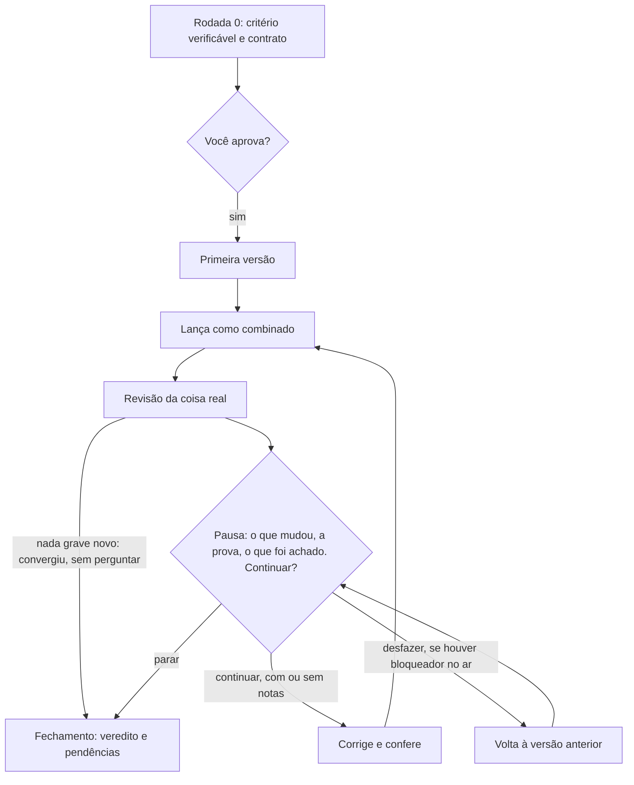

# sota

**Português** · [English](README.en.md)

**A IA responde com convicção. Como saber em qual resposta confiar? O sota faz revisores de IA trabalharem separados, cada um com um método, mostra a evidência de cada achado, diz o quanto foi conferido e devolve uma versão melhorada.**

Aceita o que estiver escrito ou construído: um plano, um texto, uma decisão, um código, uma tela.

O sota é uma *skill*, um pacote de instruções que ensina um agente de IA a trabalhar de um jeito específico. Foi testada só no [Claude Code](https://code.claude.com/docs), o agente da Anthropic que trabalha com os arquivos do seu computador, e pede um plano pago do Claude ou uma chave de API. Em uma janela de chat, como a do ChatGPT, não foi testada: sem agentes separados, cairia em um modo mais fraco.

## Um exemplo: o plano dos bolos da escola

Escrevemos um plano de teste, como o de um voluntário de escola: arrecadar US$ 5.000 para a biblioteca em um sábado, vendendo 50 bolos a US$ 10, das 9h às 11h. No último item, ele diz: "segurança alimentar não é preocupação, porque é tudo caseiro".

A skill respondeu **NOT YET** (ainda não), com isto:

- **A conta não fecha.** 50 × US$ 10 dá US$ 500, um décimo da meta. Mesmo vendendo tudo, faltariam US$ 4.500.
- **A frase sobre segurança é falsa.** Um revisor abriu normas oficiais de saúde e citou os trechos, para você mesmo conferir.
- **A meta misturava necessidade e método.** A biblioteca precisa de livros. "Um sábado" e "bolos" eram só um caminho.
- **O plano voltou reescrito**, com doações, regras para os bolos e quem cuida do dinheiro. Revisores novos testaram essa versão, e o primeiro achou um cronograma impossível de seguir. Os últimos ajustes não foram reconferidos, e o relatório avisa quais números são palpite.

Nem tudo saiu provado: dois dos sete achados graves ficaram só como coerentes e não checados (`plausible`), e o relatório diz isso. O plano original não foi tocado. A decisão continua com quem o escreveu, agora com fontes para conferir. A conta, qualquer pessoa atenta acharia; o valor está nas fontes abertas, no objetivo questionado e na versão reescrita. [Leia o relatório completo](examples/bake-sale-review.md), real e sem edição (em inglês).

### O racional em cinco linhas

- A IA responde sem mostrar o caminho, e dar a ela papéis como "o advogado" ou "o cético" muda pouco o raciocínio → **os revisores diferem no método e apontam a evidência** → você confere em vez de acreditar.
- Agentes que leem o trabalho dos outros convergem → **cada um trabalha sozinho** → um não arrasta o outro.
- Quem chegou a uma conclusão não é bom juiz dela → **um agente que não viu a discussão confere os bloqueadores, os problemas que impediriam o objetivo** → a conferência não herda o raciocínio de quem concluiu.
- Em um processo longo, rodadas sem pausa decidem por você → **você decide a cada rodada, e nenhuma mensagem sai e nada é publicado sem combinar antes** → o veto continua seu.
- Tudo isso é aposta, não resultado: ninguém mediu se supera um revisor cuidadoso.

[A história completa](#por-que-ela-funciona-assim) está mais abaixo.

## O que você quer agora?

| Sua pergunta | Modo | O que acontece | O que muda no original |
|---|---|---|---|
| "Isso está bom? O que estou deixando passar?" | **Revisão** (`review`) | Uma rodada de revisão, um relatório e uma versão melhorada | Nada, por instrução ([limites](#custo-e-limites)) |
| "Quero que isso melhore até não valer mais a pena continuar" | **Ciclo** (`loop`) | Rodadas de corrigir, conferir e revisar, parando para você decidir | Só o que você autorizou |

Na dúvida, comece pela Revisão. É mais barata e tem instrução de não mexer no original.

**Não use para** perguntas factuais rápidas, ajustes triviais ou qualquer coisa que um teste barato resolva agora.

> **Antes de instalar** ([detalhes](#custo-e-limites)):
>
> - **Custo.** As duas Revisões medidas no nível padrão (`standard`) custaram US$ 7 e mais de US$ 18, pagando por uso. Não é faixa nem teto: material maior custa mais, e o nível mais pesado (`deep`) e um Ciclo inteiro nunca foram medidos. Em uma assinatura, sai da franquia do plano.
> - **O que ela faz.** Executa código e busca na web sem pedir licença própria. Em `deep`, que ela pode escolher sozinha em algo difícil de desfazer, o material pode ir também a outra IA que esteja instalada.
> - **Se você administra sistemas neste computador,** como servidores, contas de nuvem ou bancos de dados, rode em outro ou sem esses acessos.
> - **O resultado** não substitui um profissional.

## Comece aqui

**1. Tenha o Claude Code.** Se nunca usou, instale o [app Claude](https://code.claude.com/docs/en/desktop-quickstart), entre na sua conta e abra a aba **Code**. É preciso um plano pago (Pro ou superior). Quem prefere o terminal segue o [guia de início](https://code.claude.com/docs/en/quickstart), que também aceita chave de API, paga por uso.

**2. Instale a skill.** Os dois caminhos usam git. Sem ele, instale o [Git](https://git-scm.com/downloads) antes.

- **No app** (ainda não testamos este caminho): na aba Code, escolha **Local** no seletor de ambiente e qualquer pasta. Cole a mensagem abaixo.
  ```
  Copie a pasta skills/sota de https://github.com/phrbarbosa/sota para a minha pasta de skills pessoais (~/.claude/skills/sota; no Windows, dentro da minha pasta de usuário). Não instale nem execute mais nada.
  ```
  Aprove só criar a pasta, baixar e copiar, e recuse o resto. A pasta só tem arquivos de texto, mas são instruções que o agente passará a seguir, e você pode lê-las antes. Depois, abra uma sessão nova e digite `/`: `sota` deve aparecer na lista, e o comando será `/sota`. Se não aparecer, peça ao agente para conferir se existe `SKILL.md` nessa pasta. Para atualizar ou remover, peça ao agente para substituir ou apagar essa pasta.
- **No terminal** (testado em uma instalação limpa), fora do Claude Code. O comando será `/sota:sota`.
  ```bash
  claude plugin marketplace add phrbarbosa/sota
  claude plugin install sota@phrbarbosa-sota
  ```

**3. Abra a pasta do seu arquivo.** No app, escolha o ambiente local e a pasta do arquivo. No terminal, entre na pasta e digite `claude`. O agente lê texto e PDF; se o arquivo for Word, salve como PDF antes.

**4. Peça**, trocando `plano.md` pelo seu arquivo e dizendo o objetivo. Sem objetivo, ela deduz um e avisa. Se instalou pela mensagem, use `/sota` em vez de `/sota:sota`, aqui e nos exemplos abaixo.

```
/sota:sota revise o plano em plano.md; o objetivo é pagar os livros da biblioteca
```

**5. Espere e leia.** Ela avisa em uma linha quantos agentes vai iniciar e começa sem esperar resposta, porque você a chamou pelo nome. Conte com vários minutos: medimos cerca de 7 em uma Revisão `lite` e 16 no início de um Ciclo, e não cronometramos uma `standard`. Se o Claude Code pedir permissão para buscar na web ou rodar um comando, leia o pedido: recusar pode deixar um revisor sem concluir, e o protocolo manda o relatório dizer isso. No terminal, Esc interrompe. No fim, vêm o veredito, o que mudar e a versão melhorada, inteira se o material for pequeno ou como lista de alterações se for grande.

Outros pedidos:

```
/sota:sota revise o diff deste branch; é uma migração arriscada
/sota:sota revise deep: devemos trocar de fornecedor neste trimestre?
/sota:sota revise lite o plano em plano.md
/sota:sota loop nossa página de cadastro; meta: quem chega pela primeira vez termina em menos de um minuto
/sota:sota loop a proposta em proposta.md, só no papel
/sota:sota continue pagina-de-cadastro
```

- **Nível.** O padrão é `standard`, e `deep` usa mais agentes e custa mais. Em algo difícil de desfazer ou de erro caro, ela pode escolher `deep` sozinha, sem esperar resposta: se quiser evitar, diga no pedido qual nível quer. `lite` sai mais barato porque um só agente faz as cinco leituras, sem revisores separados nem debate; no máximo, um agente novo confere a versão melhorada. Serve para coisa pequena e reversível, não para decisão difícil de desfazer nem para o que a mesma sessão acabou de produzir. O Ciclo nunca usa `lite`.
- **Ciclo.** Primeiro, ela propõe um critério e um contrato do que pode lançar, e espera a sua aprovação. `continue` retoma pelo nome que ela informou no início. "Só no papel" significa revisar e reescrever o documento sem colocar nada em uso, e costuma precisar de mais rodadas.
- **Linguagem natural.** Dá para pedir "faça um red team disso". Nesse caso, ela informa a opção mais barata e espera o seu sim. Se ela não anunciar o que vai iniciar, não foi acionada: use o comando.
- **Idioma.** O relatório vem no idioma do seu pedido, como neste [exemplo em português](examples/revisao-lite-biblioteca.md).

<details>
<summary>Outras formas de instalar e atualizar</summary>

**Skill pessoal à mão**, para usar `/sota` (precisa de git):

```bash
git clone https://github.com/phrbarbosa/sota
mkdir -p ~/.claude/skills
cp -r sota/skills/sota ~/.claude/skills/sota
```

Para atualizar, a partir da pasta onde está o clone:

```bash
git -C sota pull && rm -rf ~/.claude/skills/sota && cp -r sota/skills/sota ~/.claude/skills/sota
```

Como plugin, use `claude plugin update sota@phrbarbosa-sota` e `claude plugin uninstall sota@phrbarbosa-sota`.

**Outros agentes:** `skills/sota` segue o formato aberto [Agent Skills](https://agentskills.io/specification), então basta copiar a pasta para o diretório de skills do agente. A Revisão precisa de subagentes ou de uma CLI sem interface para ter contextos novos; sem isso, cai em um modo mais fraco e avisa. O Ciclo não roda sem eles.

</details>

## Por que ela funciona assim

### A dor: falta saber em qual opinião confiar

Volte ao voluntário dos bolos, agora sem a skill. Ele pede a uma IA para avaliar o plano, e ela responde com convicção. Talvez até acerte a conta. Mas, quando disser algo sobre os cuidados com os bolos, como saber se aquilo foi checado ou apenas soa bem? A resposta traz uma opinião sem o caminho até ela. Pedir de novo traz outro texto tão convicto quanto.

Falta opinião? Não. **Falta um jeito de saber em qual opinião confiar.** É esse o problema que o projeto ataca.

### A ideia óbvia: um painel de personagens, e por que não bastou

A solução intuitiva é montar um painel: cinco personagens de IA ("o advogado", "o cético", "o especialista") e um juiz. O que se encontrou pelo caminho levou a outro desenho:

- **Papéis mudam menos do que parece.** Em um estudo, três agentes do mesmo modelo com papéis diferentes deram justificativas [muito parecidas](https://arxiv.org/abs/2604.03809) para 100 questões de matemática (similaridade média de 0,888). E personas [não melhoram a precisão de forma confiável](https://arxiv.org/abs/2311.10054). *Por isso os revisores diferem no que fazem, não em quem fingem ser.*
- **Agentes que leem os outros convergem.** Quando agentes leem o trabalho completo uns dos outros, as propostas [convergem já na primeira rodada](https://arxiv.org/abs/2608.23541). *Por isso cada revisor trabalha sozinho até entregar o relatório; o debate, se houver, vem depois.*
- **O erro próprio passa mais fácil.** Uma mesma afirmação errada foi [corrigida bem mais](https://arxiv.org/abs/2606.05976) quando rotulada como vinda de fora do que como pensamento do próprio modelo (de 23 a 93 pontos percentuais a mais, significativo em 10 de 12 cenários). O estudo troca o rótulo e não testa revisores novos. *Usar agentes novos, que não viram o trabalho nascer, é a nossa aposta a partir disso.*
- **Um lado só engana.** Dois debatedores em lados opostos [levaram juízes humanos a acertar mais](https://arxiv.org/abs/2402.06782) (de 60% para 88%). Com um único advogado o ganho foi menor (78%), e, com juízes de IA, advogados otimizados para persuadir pioraram o acerto. *Por isso o debate sempre tem dois lados.*

Em boa parte, são preprints recentes em testes estreitos: motivam o desenho, sem prová-lo. Nenhum testa revisores de métodos diferentes na mesma IA contra um revisor único; essa solução é inferência deste projeto. E os estudos que mostram ganho com diversidade variam o modelo de IA, o que aqui normalmente não acontece.

### O desenho: evidência em vez de opinião

Voltando à dor: se o problema é não saber em qual opinião confiar, um revisor não pode só opinar. Cada achado precisa apontar para algo que você consiga abrir, como uma conta refeita, uma fonte citada ou um teste rodado, e dizer se foi verificado ou é só plausível. Sem isso, vira especulação e pode ser descartado. E, como papéis pouco mudam, os revisores diferem no que fazem:

| Revisor | O que faz | Ilustração com o plano dos bolos |
|---|---|---|
| Verificador | Executa, abre as fontes, refaz as contas | 50 × 10 = 500 |
| Red Team | Imagina que já deu errado e pergunta por quê | Vendeu bem e ainda faltaram US$ 4.500 |
| Defesa | Monta a melhor versão e diz o que proteger | A simplicidade dos quatro passos |
| Visão de fora | Busca como coisas parecidas se saíram | Outras vendas de bolo: de £ 300 a US$ 2.456, em amostra não representativa |
| Pragmático | Percorre a experiência de cada pessoa afetada | Quem tem alergia não sabe o que há no bolo |

Isso não garante achados diferentes. Aquela revisão teve um sexto revisor, extra, focado em fontes de segurança alimentar, e dele veio o achado exclusivo mais útil, sobre regras locais. Ainda assim, 6 dos 7 achados graves vieram de mais de um revisor, 4 deles de todos os seis, e o relatório conta os idênticos como uma voz só. O que muda é o tipo de evidência que cada um precisa trazer para você abrir. Se isso também traz achados novos em material difícil, não medimos.

A revisão segue cinco passos, cada um por causa de uma falha:

1. **Sem contaminação.** Cada revisor trabalha sozinho e sem memória da conversa.
2. **Uma frase confiante não é evidência.** Um presidente lê os relatórios um a um, abre as evidências dos achados graves e rebaixa o que não se sustenta.
3. **Em debate, o discurso muda [mais fácil que a posição](https://arxiv.org/abs/2609.08016).** Só há debate em discordância real ou em bloqueador (achado que impede o objetivo) levantado por um único revisor, com dois lados opostos e evidência na mão. Mudar de posição só conta com evidência nova.
4. **Quem concluiu não confere a si mesmo.** O presidente não conta a própria síntese como verificada. Um bloqueador que sobrevive vai a um agente novo, que recebe só o objetivo, o material e os achados, sem a discussão. Em um caso do uso do autor, sem registro público, um defeito passou por seis revisores e só essa última conferência o pegou.
5. **Opinião sem caminho não se contesta.** Você recebe veredito e confiança, o que mudar (com evidência e correção), o que manter, a versão melhorada dizendo se foi conferida, as discordâncias não resolvidas, o que mudaria o veredito e o teste mais barato para descobrir. Com isso, você pode discordar, e a decisão continua sua.

As principais regras têm sua base em [`evidence.md`](skills/sota/references/evidence.md), entre pesquisa e notas de uso. Outras, como os limites numéricos, são escolhas de projeto.

### O que deu errado no uso real e virou regra

O Ciclo nasceu de outra fonte: o autor rodou cerca de dez ciclos e algumas revisões em um único produto real, antes do formato atual, e foi errando. Numa dessas vezes, deixou correr 13 rodadas sem parar. Cada regra abaixo veio de um tropeço assim:

| O que aconteceu | A regra que nasceu |
|---|---|
| 13 rodadas sem pausa: 13 rodadas de decisões que o autor não pôde vetar | **Você decide a cada rodada.** Nada é corrigido antes de você ver. Ela só deixa de perguntar quando a rodada não acha nada grave novo |
| Revisar no papel levou 6 rodadas; as 2 primeiras na coisa real acharam defeitos que o papel não mostrava | **Revise a coisa real**: a tela rodando, o texto testado com leitores simulados, as contas refeitas |
| As 4 últimas rodadas de um ciclo só acharam estragos causados pela correção anterior | **Confira cada correção no conjunto, e cada estrago ganha uma guarda:** uma checagem que você viu falhar antes do conserto. A que nunca falhou pode não estar checando nada |
| Consertos inventaram frases sem fonte: 4 de 7 problemas graves em um ciclo de mensagens | **Frase nova precisa de fonte**, mesmo dentro de uma correção |

Uma regra vem de bom senso: **nenhuma ação para fora sem contrato.** Pedir a skill não autoriza enviar, publicar, implantar nem comprar. No início do Ciclo, você aprova um contrato do que "lançar" significa (o padrão é só arquivos locais), e passos irreversíveis são confirmados de novo na hora.

São observações de uma só pessoa, sem registro público e sem controle. Não se mediu se as regras resolvem esses problemas, e o registro publicado do Ciclo atual vai só até a primeira pausa.

<details>
<summary>O Ciclo em um diagrama</summary>



Se o assunto já existe, a primeira rodada só o revisa, sem lançar nada. Partindo do zero, pode haver até duas revisões no papel antes de construir. O Ciclo também para se a checagem falhar duas vezes ou se não der para provar que o lançamento funcionou.

</details>

## Custo e limites

Se a promessa é mostrar a evidência, ela vale aqui também.

### O que ela faz sem pedir

- **Seu material vai para o modelo de IA,** como em qualquer uso do Claude Code. Em `deep`, ou sem subagentes, ela pode usar a CLI de outro fornecedor que esteja instalada, como Codex ou Gemini, e o material vai também para ele. A skill só pede o seu sim se considerar o material pessoal, de saúde, jurídico, financeiro, de cliente ou secreto. Se isso importa, diga no pedido para não usar outro fornecedor.
- **Busca na web.** Os revisores buscam perguntas gerais, com instrução para não incluir nomes nem trechos do material.
- **Executa código.** O Verificador experimenta em uma cópia, com instrução de não tocar em produção nem em contas reais. São instruções, não barreiras testadas: se neste computador há chaves de acesso, senhas em arquivo ou ferramentas ligadas a sistemas reais, rode em outro ou sem esse acesso.
- **Cria arquivos.** Pode criar arquivos novos, como o relatório. No Ciclo, versiona cada rodada e mantém um registro em `.sota/<nome>/LEDGER.md` que copia suas palavras ao pé da letra. Se você publica a pasta, deixe esse arquivo de fora.

A skill não pede licença própria para isso, mas o Claude Code pode pedir, conforme a sua configuração.

### Quanto custa

Uma Revisão `standard` inicia 5 agentes, até 10 a mais se houver o que disputar e até 2 para conferir no fim. `deep` e revisores extras, focados no tema, somam mais; em direito, medicina, finanças ou segurança, um extra é obrigatório. Um Ciclo que parte do zero pode fazer até três revisões antes da sua primeira decisão sobre uma versão real, e mais uma por rodada, além dos consertos. Medido a preços de API, em que se paga por uso, em um modelo da classe Opus:

| Execução | Custo |
|---|---|
| Revisão `lite` de um plano curto | US$ 1,57 |
| Revisão `standard` de um plano curto | US$ 7,24 |
| Início de Ciclo em uma mensagem curta, até a primeira pausa, sem nenhum conserto | US$ 7,25 |
| Revisão `standard` deste repositório | US$ 18,13, provavelmente subestimado: exclui a montagem do relatório, usou um modelo mais barato no debate, e não sabemos se conta os agentes que ela inicia |

São quatro execuções, não uma média, e nem `deep` nem um Ciclo inteiro foram medidos. A skill não tem teto em dinheiro. Em uma assinatura, tudo isso consome a franquia do plano, e não medimos quanto. Se o limite chegar no meio, ela tenta aquele revisor mais uma vez; se falhar de novo, o relatório diz qual faltou e limita a confiança a média. Se o limite parar a sessão inteira, pode não haver relatório; não testamos esse caso.

### O que ainda não se sabe

- **Não foi medido se esse conjunto de revisores supera um revisor cuidadoso.** Foi desenhado para errar menos, e isso segue sem teste.
- **Um relatório confiante ainda é opinião de IA.** Abra a evidência dos achados que vão mudar sua decisão. Em direito, medicina, finanças ou segurança, use o resultado para preparar a conversa com um profissional, sem substituí-la.
- **Os revisores normalmente são a mesma IA**, o mesmo *modelo*, e podem errar juntos. Por isso, concordar aumenta a prioridade de conferir, não a certeza.
- **Nem sempre converge.** Três ciclos anteriores, ainda na versão que originou este protocolo, tiveram `9 → 4 → 5 → 2`, `9 → 7 → 7 → 7` e `13 → 15 → 14` problemas graves por rodada. Nenhum chegou a zero. Segundo o relato do autor, sem registro público, cada um parou por decisão, quando os achados deixaram de valer outra rodada.
- **Os testes do repositório só checam se ela se comporta como combinado,** sem medir a qualidade da revisão. Os de não enviar, de parar para pedir aprovação e de não tocar no original passam até sem a skill, então não provam que é ela quem garante isso.
- **Só foi testada no Claude Code**, e nenhuma pessoa de fora percorreu a instalação e uma revisão completa.

Quer tirar a prova sem confiar nesta página? Rode uma Revisão em algo cujo problema você já conhece, sem contar qual é, e veja se ela acha.

## Exemplos com saída real

As entradas dos três primeiros foram escritas como teste. Os relatórios estão sem edição, salvo onde indicado.

- [Plano de leitura de uma biblioteca](examples/revisao-lite-biblioteca.md) (em português): uma Revisão `lite`.
- [Plano de venda de bolos da escola](examples/bake-sale-review.md) (em inglês): uma Revisão completa, com a entrada.
- [Comunicado de um clube](examples/club-announcement-loop.md) (em inglês): o início de um Ciclo só no papel, até a primeira pausa.
- [Este repositório antes de publicar](examples/self-review.md) (em inglês): a revisão que mudou esta versão, com achados contra a própria skill e erros nos próprios consertos.

## Glossário

Os relatórios podem usar estes termos:

| Termo | Significado |
|---|---|
| Agente | Uma IA que executa tarefas, além de conversar |
| Modelo | A IA que está por trás do agente, como o Claude Opus |
| Curia (cúria) | O conselho: os revisores e o presidente |
| Assento (*seat*) | Um revisor, definido pelo método que segue |
| Presidente (*Chair*) | Quem lê os relatórios, confere as evidências e dá o veredito |
| Blocker (bloqueador) / major | Problema que impede o objetivo ou causa dano inaceitável / que o prejudica muito. Juntos, são os achados "graves" desta página |
| `verified` / `plausible` / `speculative` | O achado foi checado / é coerente e ninguém refutou, mas não foi checado / não tem evidência que se possa abrir |
| *Curated version* | A versão melhorada que vem no relatório |
| Contrato de release | O que "lançar" significa aqui, combinado por escrito no início |
| Guarda (*guard*) | Checagem que se viu falhar antes do conserto e que fica para pegar a volta do defeito |
| *Ledger* | O arquivo que guarda o estado do Ciclo entre rodadas |

O nome vem de *state of the art*, estado da arte.

## Contribuir

Veja [CONTRIBUTING.md](CONTRIBUTING.md). Toda mudança de protocolo precisa dizer por quê: um artigo, uma execução que falhou, um efeito medido.

## Licença

[MIT](LICENSE)
